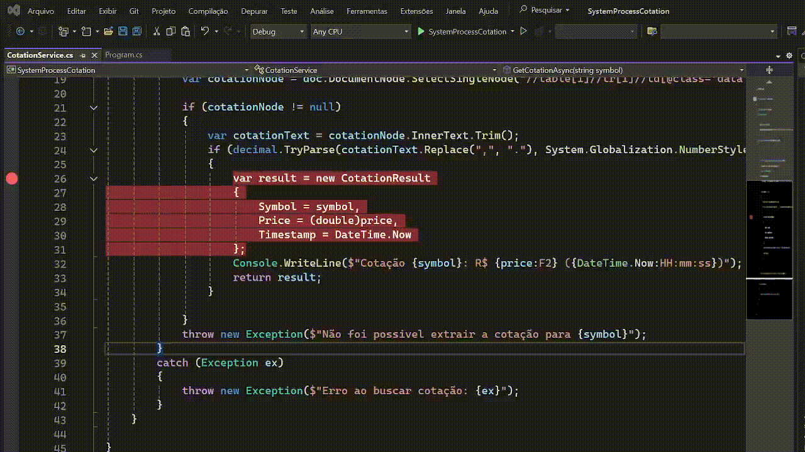

# System Process Cotation



Monitoração de preços que envia alertas por email de quando comprar/vender ao atingir um limite.

### features extras:
+ mensagens mais detalhadas no console
+ sistema só envia um novo alerta se o preço mudar, evitando spam
+ intervalo para as verificações da cotação

### como executar
```bash
dotnet run -- --help
```

A ajuda aceita `help`, `-h`, `--help`, `-?`, `/h` ou `/?`.

dotnet run **Ativo preçoVenda preçoCompra [intervaloMs] [cooldownSegundos]**

```bash
dotnet run PETR4 22.67 22.59
```

Para uma demonstração mais rápida, informe também o intervalo de consulta e o cooldown entre alertas:

```bash
dotnet run PETR4 22.67 22.59 1000 15
```

O ativo é normalizado a partir de formatos comuns da B3, como `BVMF:PETR4`, `PETR4.SA`, `PETR4.BVMF` ou `PETR4.BOVESPA`.

Os preços aceitam ponto ou vírgula decimal, marcadores como `R$ 35,50`, grupos como `1'234.56` e trechos copiados de cotação, como `31,42 +0,50%`.

A extração da cotação tenta células rotuladas, atributos como `data-price`, `aria-label` e `title`, metadados/JSON-LD e, por fim, células destacadas do layout.

### Barramento SNS/SQS

O consumidor aceita tanto mensagens SQS cruas quanto envelopes SNS. Mensagens vazias, JSON inválido ou payloads de domínio inválidos são registrados e removidos antes de alcançar os workers, para não travar a fila em repetição; falhas no handler ficam na fila para retentativa do SQS.

Para exigir ordenação, dê ao canal o sufixo `.fifo` (por exemplo, `cotations.fifo`). O barramento cria o tópico SNS e a fila SQS como FIFO, habilita deduplicação baseada no conteúdo no tópico e publica cada mensagem no grupo do próprio canal.

### Validação de mensagens

Antes de aplicar regras ou enviar email, o sistema valida os dados recebidos. Cotações precisam ter ativo válido, preço positivo e finito e horário inicializado. Alertas também precisam ter tipo conhecido e preço-alvo válido; alertas inválidos são registrados e ignorados sem criar chave no Redis ou tentar SMTP.

### Gerar executável
```bash
dotnet publish -c Release -r win-x64 --self-contained true /p:PublishSingleFile=true
```

### Executar o arquivo
```bash
bin\Release\net9.0\win-x64\publish\SystemProcessCotation.exe PETR4 35.00 30.00
``` 

### Executando no Windows através do powershell
```powershell
Set-ExecutionPolicy Unrestricted
``` 

### Executar com um script pronto
```powershell
.\script.ps1 PETR4 35.00 30.00
``` 

### Configuração

Configure o SMTP renomeando `.env.example` para `.env` e edite os campos.

As variáveis curtas (`HOST`, `PORT`, `USERNAME`, `PASSWORD`, `FROM`, `TO`, `ENABLE_SSL`) continuam funcionando. Também é possível usar aliases de deploy: `SMTP_HOST`, `SMTP_PORT`, `SMTP_USERNAME` ou `SMTP_USER`, `SMTP_PASSWORD`, `SMTP_FROM`, `SMTP_TO`, `SMTP_ENABLE_SSL`, `SMTP_SSL` ou `SMTP_TLS`.

Para trading, também são aceitos aliases como `TICKER`, `SELL_THRESHOLD`, `BUY_THRESHOLD`, `POLLING_INTERVAL_MS` e `COOLDOWN_SECONDS` quando a plataforma de deploy não usa a seção `Trading`.
